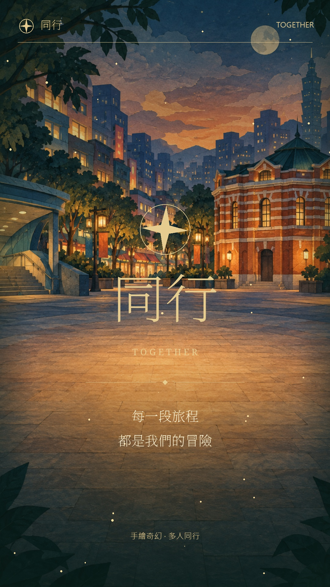

# 同行 · Together｜手繪奇幻冒險版

手機優先的多人旅行 app，從四位紙片旅人的等待大廳開始。大家聊天、發貼圖；隊長選西門町地圖和集合地，開始冒險後，各自選下一站，透過圓形頭像、移動動畫和集合旗幟看見彼此。

[線上私人預覽](https://ximen-together-tales.qd7779winston.chatgpt.site) · [下載 60 秒亮點影片](https://github.com/Weiqd7779/together-travel/releases/tag/adventure-preview-2026-10-04) · [分鏡與素材](../output/together-adventure-storyboard.md)

[](https://github.com/Weiqd7779/together-travel/releases/tag/adventure-preview-2026-10-04)

## 核心體驗

- 開場直接進入手繪暮光大廳，角色進場、聊天與六款貼圖。
- 隊長選圖、設定集合地，再讓全隊進入冒險。
- 滿版手繪地圖可拖曳及縮放；唐吉訶德、阿宗麵線、電影街、萬年大樓和紅樓有識別圖示。
- 每位旅人獨立選擇目的地，以圓形頭像呈現出發動畫與位置狀態。
- 集合地以金色旗幟標示，先抵達者會顯示抵達標記。
- 建立房間、分享邀請連結；最多十二人，房間有效期七天，每三秒同步。
- 預設四人示範，點選夥伴可切換旅人，單人也能體驗完整流程。

這是 repo 內獨立的冒險版；根目錄的原有共遊行程版可繼續從根目錄執行。

## 本機啟動

需要 Node.js 22.13 以上。從此資料夾安裝並建置，產生本機 Worker 設定：

```powershell
cd adventure-app
npm ci
npm run build
```

第一次建立本機資料庫時，按順序套用三個遷移：

```powershell
node --import ./scripts/sites-env.mjs ./node_modules/wrangler/bin/wrangler.js d1 execute DB --local --config dist/server/wrangler.json --persist-to .wrangler/state --file drizzle/0000_petite_zemo.sql
node --import ./scripts/sites-env.mjs ./node_modules/wrangler/bin/wrangler.js d1 execute DB --local --config dist/server/wrangler.json --persist-to .wrangler/state --file drizzle/0001_known_thena.sql
node --import ./scripts/sites-env.mjs ./node_modules/wrangler/bin/wrangler.js d1 execute DB --local --config dist/server/wrangler.json --persist-to .wrangler/state --file drizzle/0002_orange_pepper_potts.sql
npm run dev
```

開啟 http://127.0.0.1:5173/ 。資料庫會保存在忽略版控的 `.wrangler/state/`；已套用的遷移不要重複執行。修改期間也可使用 `npm start` 預覽建置後的 Worker。

## 驗證

```powershell
node node_modules/typescript/bin/tsc --noEmit
npm run build
node --test test/rooms.test.mjs
```

整合測試須在本機服務啟動、D1 遷移完成後執行。它驗證兩位旅人的房間加入、聊天貼圖、隊長權限、開始冒險、各自移動、提前抵達和房間隔離。這次上傳的實作已通過 TypeScript、正式版建置與該整合測試。

## 位置與分享

地圖為手繪示意，位置由本人回報；目前沒有 GPS 定位或導航。出發動畫用於呈現目的地切換。線上版本目前為私人預覽，邀朋友加入前需先調整網站的分享存取設定。

## 素材與影片

原創美術位於 `public/art/`：暮光集合廣場、平面街區和四位透明背景旅人，由內建 imagegen 產生。使用紙片民俗插畫與奇幻冒險氣氛，沒有使用 Wildermyth 遊戲原始素材。

影片為 60 秒、1080 × 1920、24 fps 直式動態圖像，中文字幕與原創合成配樂，無旁白。MP4 放在 GitHub Release，封面、地圖預覽和分鏡放在 repo 的 `output/`。更多操作與素材主題見 [PRODUCT.md](PRODUCT.md)。

## 程式位置

- `app/page.tsx`、`app/globals.css`：大廳、地圖、聊天、旗幟與手機操作介面。
- `app/api/rooms/route.ts`：房間加入、訊息、出發、抵達與隊長權限。
- `lib/travel.ts`、`lib/room-store.ts`：目的地、移動狀態及房間資料。
- `db/`、`drizzle/`：D1 資料表與遷移。
- `test/rooms.test.mjs`：多人房間整合情境。

框架為 React、Vinext 和 Cloudflare D1，保留 Sites starter 的建置支援。`.openai/hosting.json` 連結既有 Sites 專案；沒有包含部署憑證、登入 token、使用者資料庫或影片建置暫存檔。
